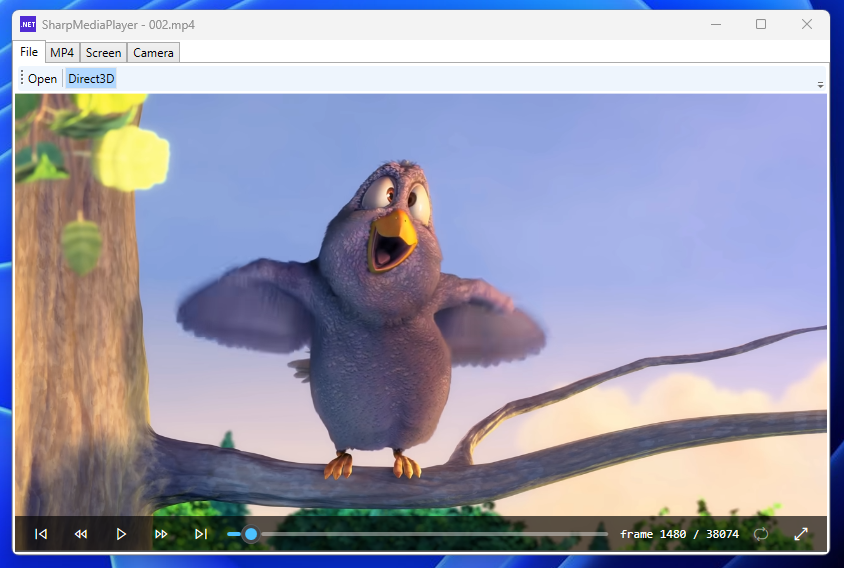

# Sharp Media Foundation Interop
Simple Windows Media Foundation interop written in C#. No native dependencies, only managed code.

[](https://www.nuget.org/packages/SharpMediaFoundationInterop)

## Platforms and codecs
The library is a single `net8.0`/`net10.0` DLL with no native dependencies. `MediaCodecs` and `MediaDevices` pick whatever the current system has. On an unsupported system, `CanDecode`/`CanEncode` return false, the device lists are empty, and creating a codec or device throws `PlatformNotSupportedException`.

D = decode, E = encode, — = not available.

| | Windows | macOS | iOS | Android | Linux |
|---|---|---|---|---|---|
| Minimum version | 10 1809 | 11 | 14 | 8 | any with GStreamer |
| Backend | Media Foundation, waveOut/waveIn, DXGI | VideoToolbox, AudioToolbox, AudioQueue, AVFoundation, ScreenCaptureKit | VideoToolbox, AudioToolbox, AudioQueue, AVFoundation, ReplayKit | MediaCodec, AAudio, Camera2 (NDK) | GStreamer, PipeWire portal |
| **Video** | | | | | | 
| H264 | D E | D E | D E | D E | D E |
| H265 | D E ¹ | D E | D E | D E | D E |
| AV1 | D E ¹ | D ² | D ² | D E | D E |
| VP9 | D E ¹ | D ² | — | D E | D E |
| MPEG-1/2 | D ¹ | D | — | D ² | D |
| H263 | D | D | — | D ² | D |
| MPEG-4 Part 2 | D | D | D | D ² | D |
| Motion JPEG | D | — | — | — | — |
| ProRes | — | D E | D E ² | — | D E |
| **Audio** | | | | | |
| AAC | D E | D E | D E | D E | D E |
| MP3 | D E | D | D | D | D E |
| MP2 | D | — | — | — | — |
| FLAC | D E | D E | D E | D E | D E |
| ALAC | D E | D E | D E | D ² | D E |
| Opus | D | D E | D E | D E | D E |
| PCM, G.711 | D | D | D | D | D |
| **Devices** | | | | | |
| Screen capture | ✓ | ✓ (12.3) | own app only (16) | — | ✓ (Wayland portal) |
| Camera, audio in/out | ✓ | ✓ | ✓ | ✓ | ✓ |

¹ Requires the matching Microsoft Store extension (HEVC is paid).
² Not on every device; `MediaCodecs.CanDecode`/`CanEncode` report it.

## Video decoding
Create and initialize the decoder; every codec has the same API. The size is the coded one, as the stream's parameter sets give it:
```cs
var options = new VideoDecoderOptions
{
   Width = width,
   Height = height,
   FpsNom = timescale,               // a hint; 0 over 0 where the stream does not say
   FpsDenom = defaultSampleDuration,
};
using (var videoDecoder = MediaCodecs.CreateVideoDecoder(VideoCodec.AV1, options))
{
   videoDecoder.Initialize();
   ...
}
```
Frames come out as NV12, padded to the size the decoder works in: `videoDecoder.Width` by `videoDecoder.Height`, or `MediaCodecs.DecoderAlignment(codec)` before there is a decoder. Create a buffer to hold the decoded frame:
```cs
var nv12Buffer = new byte[videoDecoder.OutputSize];
```
Pass the frame to the decoder and get the output. A decoder hands frames out in display order, each with the timestamp of the input it came from. On macOS, where VideoToolbox hands them out in decode order, they are put in order by those timestamps, so give each frame its own:
```cs
IEnumerable<byte[]> units = ...; // get a list of NALU/OBU from your video source
foreach (var unit in units)
{
   if (videoDecoder.ProcessInput(unit, timestamp))
   {
      while (videoDecoder.ProcessOutput(ref nv12Buffer, out _, out long frameTime))
      {
         // nv12Buffer holds the decoded nv12 frame
         ...
      }
   }
}
```
At the end of the stream, drain the frames the decoder still holds, and read them out before taking input again - audio decoders and encoders alike:
```cs
videoDecoder.BeginDrain();
while (videoDecoder.ProcessOutput(ref nv12Buffer, out _, out long frameTime))
{
   ...
}
videoDecoder.EndDrain();
```
## Color conversion
`MediaCodecs.CreateColorConverter` converts between NV12, YUY2, UYVY, RGB24, RGB32 and ARGB32. It uses the system's converter where there is one. Otherwise it uses `ManagedColorConverter`, which converts YUV to RGB and RGB to NV12.

RGB rows are bottom-up by default, as in Media Foundation; set `TopDown` for a bitmap's order. Convert a decoded frame to RGB for display:
```cs
var options = new ColorConverterOptions
{
   Width = width,
   Height = height,
   Matrix = ColorMatrix.Default, // BT.709 from 720 lines, else BT.601; or Bt601, Bt709, Bt2020
   FullRange = false,
   TopDown = true,
};
using (var converter = MediaCodecs.CreateColorConverter(MediaFormats.NV12, MediaFormats.RGB32, options))
{
   converter.Initialize();

   var rgbBuffer = new byte[converter.OutputSize];
   if (converter.ProcessInput(nv12Buffer, frameTime) && converter.ProcessOutput(ref rgbBuffer, out _))
   {
      // rgbBuffer holds the frame as B, G, R and alpha
      ...
   }
}
```
## Video encoding
Create and initialize the encoder; every codec has the same API:
```cs
var options = new VideoEncoderOptions
{
   Width = width,
   Height = height,
   FpsNom = timescale,
   FpsDenom = defaultSampleDuration,
   Bitrate = 8000000,
   RateControl = RateControlMode.ConstantQp, // or Default, ConstantBitrate, VariableBitrate, Quality
   Qp = 24,
   KeyFrameInterval = 60,                    // 0 leaves it to the encoder
};
using (var videoEncoder = MediaCodecs.CreateVideoEncoder(VideoCodec.H265, options))
{
   videoEncoder.Initialize();

   // support for each setting varies by codec and vendor: a setting the encoder did not take is reported, not thrown
   foreach (var setting in videoEncoder.UnappliedSettings)
      Console.WriteLine(setting);
   ...
}
```
The encoder takes NV12. Convert RGB to it with a color converter, as in [Color conversion](#color-conversion), from `MediaFormats.RGB32` to `MediaFormats.NV12`.

Each access unit comes out in Annex B, with its start codes; a key frame has the parameter sets in front of it. 

Create a buffer to hold the encoded NALU/OBU:
```cs
var au = new byte[videoEncoder.OutputSize];
```
Read encoded NALU/OBU:
```cs
if (videoEncoder.ProcessInput(nv12Buffer, timestamp))
{
   while (videoEncoder.ProcessOutput(ref au, out var length))
   {
      // au buffer holds the encoded access unit
      var parsedAU = AnnexBUtils.ParseNalu(au, length);
      foreach (var unit in parsedAU)
      {
         // here you can access the individual NALU/OBU
      }
   }
}
```
## Audio decoding
Create and initialize the decoder. 
```cs
var options = new AudioDecoderOptions
{
   Channels = channelCount,
   SampleRate = samplingRate,
   Config = aacTrack.AudioSpecificConfig.ToBytes(), // AAC
   SkipSamples = opusTrack.PreSkip,                 // Opus
};
using (var audioDecoder = MediaCodecs.CreateAudioDecoder(AudioCodec.AAC, options))
{
   audioDecoder.Initialize();
   ...
}
```
AAC and MP3 decode to 16 bit PCM, Opus to 32 bit float, FLAC and ALAC to PCM of the stream's own bits. Create a buffer to hold the decoded frame:
```cs
var pcmBuffer = new byte[audioDecoder.OutputSize];
```
Pass the frame to the decoder and get the output:
```cs
IEnumerable<byte[]> audioFrames = ...; // get a list of frames from your audio source
foreach (var audioFrame in audioFrames)
{
   if (audioDecoder.ProcessInput(audioFrame, 0))
   {
      while (audioDecoder.ProcessOutput(ref pcmBuffer, out var length))
      {
         // pcmBuffer holds the decoded audio
         ...
      }
   }
}
```
## Audio encoding
Create and initialize the encoder. 
```cs
var options = new AudioEncoderOptions { Channels = channelCount, SampleRate = samplingRate };
using (var audioEncoder = MediaCodecs.CreateAudioEncoder(AudioCodec.AAC, options))
{
   audioEncoder.Initialize();

   // the AudioSpecificConfig, for the MP4 file's esds box
   byte[] audioSpecificConfig = audioEncoder.Config;
   ...
}
```
Create a buffer to hold the encoded frame:
```cs
var aacBuffer = new byte[audioEncoder.OutputSize];
```
Pass the frame to the encoder and get the output:
```cs
IEnumerable<byte[]> pcmFrames = ...; // get a list of frames from your audio source
foreach (var pcmFrame in pcmFrames)
{
   if (audioEncoder.ProcessInput(pcmFrame, 0))
   {
      while (audioEncoder.ProcessOutput(ref aacBuffer, out var length))
      {
         // aacBuffer holds the encoded AAC audio
         ...
      }
   }
}
```
## Devices
`MediaDevices` lists the system's devices with `GetScreens()`, `GetCameras()`, `GetAudioOutputs()` and `GetAudioInputs()`, each a `MediaDevice` with an `Id` and a `Name`, and creates them. Leave the device null for the system's default.

### Screen capture
Captures a screen as 32 bit BGRA (on Windows, with the [DuplicateOutput1](https://learn.microsoft.com/en-us/windows/win32/api/dxgi1_5/nf-dxgi1_5-idxgioutput5-duplicateoutput1) API; on macOS, with [ScreenCaptureKit](https://developer.apple.com/documentation/screencapturekit), at the display's size in pixels). Rows are bottom-up by default, as Media Foundation's RGB formats are, or top-down, as a bitmap is:
```cs
var screens = MediaDevices.GetScreens(); // the primary first
using (var screenCapture = MediaDevices.CreateScreenCapture(screens.First(), topDown: false))
{
   screenCapture.Initialize();
   ...
}
```
Create a buffer to hold the sample:
```cs
var buffer = new byte[screenCapture.OutputSize];
```
Read the sample. A frame is returned only when the screen has changed:
```cs
if (screenCapture.ReadSample(buffer, out var timestamp))
{
   // captured screen is in the buffer
}
```
### Camera capture
Captures a camera (on Windows, any Media Foundation video capture device such as a webcam; on macOS, with AVFoundation, as NV12) in the best format it offers, which `OutputFormat` reports:
```cs
var cameras = MediaDevices.GetCameras();
using (var camera = MediaDevices.CreateCameraCapture(cameras.First()))
{
   camera.Initialize();
   ...
}
```
Create a buffer to hold the sample:
```cs
var buffer = new byte[camera.OutputSize];
```
Read the sample:
```cs
if (camera.ReadSample(buffer, out var timestamp))
{
   // captured image is in the buffer
}
```
### Audio input
Records PCM (on Windows, with the [waveIn](https://learn.microsoft.com/en-us/windows/win32/api/mmeapi/nf-mmeapi-waveinopen) API; on macOS, with [AudioQueue](https://developer.apple.com/documentation/audiotoolbox/audio-queue-services)):
```cs
using (var audioInput = MediaDevices.CreateAudioInput(sampleRate, channelCount, bitsPerSample))
{
    ...
}
```
Subscribe the `FrameReceived` callback:
```cs
audioInput.FrameReceived += (sender, e) => 
{
    byte[] pcmData = e.Data;
    ...
};
```
Recording starts right after you call `Initialize`, and stops with `Reset` or `Dispose`:
```cs
audioInput.Initialize();
```
### Audio output
Plays PCM (on Windows, with the [waveOut](https://learn.microsoft.com/en-us/windows/win32/api/mmeapi/nf-mmeapi-waveoutopen) API; on macOS, with AudioQueue):
```cs
using (var audioOutput = MediaDevices.CreateAudioOutput(sampleRate, channelCount, bitsPerSample))
{
    audioOutput.Initialize();
    ...
}
```
To play audio, enqueue it. `QueuedFrames` is the number of buffers still to play, `GetPosition()` the bytes played so far, and `Pause`, `Resume` and `Reset` control playback:
```cs
byte[] pcmSample = ...
audioOutput.Enqueue(pcmSample, (uint)pcmSample.Length);
```
More than two channels are played on the speakers they are for, in WAVE's order (`SpeakerLayout.ChannelMask`); Windows mixes them down to fewer speakers. `MediaDevices.GetSpeakerChannels()` is how many speakers the default output has, as Windows' speaker configuration says.

## Video control
`MediaControl` (drawn into a bitmap) and `GpuMediaControl` (drawn with Direct3D) play a video source, with a bar of controls over the bottom of the video.

## Samples
The console samples run on Windows, macOS and Linux alike; the WPF player is Windows' alone. The recorders take how long to record, in seconds, as their first argument - `dotnet run -- 10` - or record until a key is pressed.

### SharpMediaPlayer
Sample WPF video player that supports RTSP real-time video, MP4 files, AVIF/HEIC/HEIF images, screen capture and Media Foundation devices such as a webcam.


### SharpMediaTranscoder
Demonstrates how to transcode H264 fragmented MP4 into H265 fragmented MP4.

### SharpScreenCapture
Demonstrates how to capture the screen and encode it into H265 MP4.

### SharpWavePlayer
Shows how to play AAC audio from a MP4 file.

### SharpWebcamRecorder
Shows how to capture video from a webcam and record it into H265 MP4.
